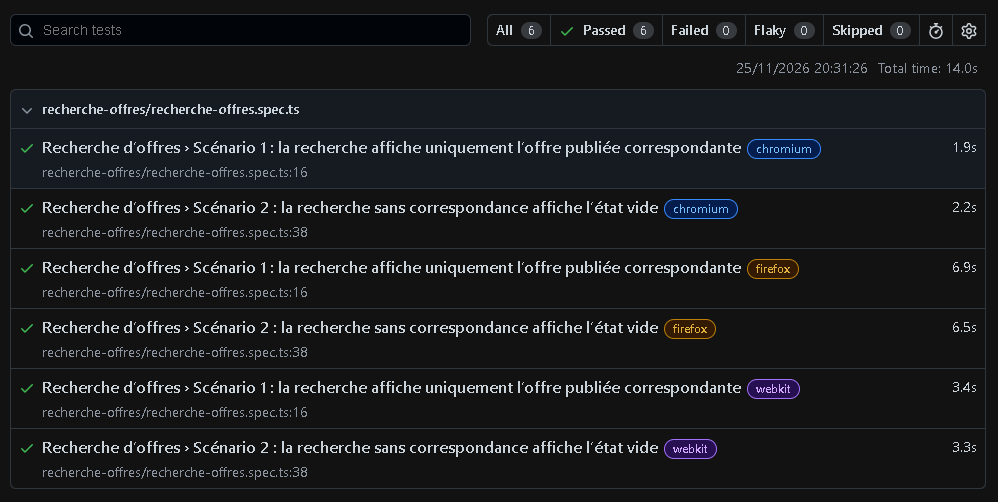

# Semaine 5 — MCP et tests E2E Playwright

## Scénarios

Les scénarios sont décrits dans [e2e/recherche-offres/scenarios.md](../e2e/recherche-offres/scenarios.md).
Le scénario 1 vérifie une recherche nominale sans tenir compte de la casse ni des espaces
externes, et que l’offre attribuée reste invisible pour l’étudiant. Le scénario 2 vérifie le
cas limite d’une recherche sans résultat et l’état vide correspondant.

## Playwright MCP

Cette partie n’a pas pu être menée à bien. Malgré plusieurs tentatives, nous ne sommes pas
parvenus à utiliser le serveur MCP avec l’agent.

## Playwright Test

Le fichier [recherche-offres.spec.ts](../e2e/recherche-offres/recherche-offres.spec.ts)
contient deux tests UI. Le scénario 1 se connecte comme Lucas Dupont, recherche
`  APPLICATION  `, vérifie qu’une seule ligne est affichée avec l’offre « Application React
de gestion de flotte » et que l’offre attribuée n’est pas présente. Le scénario 2 recherche
`stage introuvable 9x7q`, vérifie l’absence de ligne et le message d’état vide.

Les tests sont indépendants et ne modifient pas les données ; ils s’appuient sur les données
de démonstration documentées dans [seed.md](./seed.md). Pour retrouver exactement ce jeu,
la base doit être réinitialisée avant l’exécution ; cette opération réinitialise la base locale.

Résultats :

**Première exécution :**

    $ npx playwright test

    Running 6 tests using 6 workers
     6 passed (19.2s)

    To open last HTML report run:

    npx playwright show-report

**Deuxième exécution :**

**Vérification avec `npm run check` :**

    $ npm run check

    > check
    > npm run lint && npm run typecheck && npm run test && npm run build

    > lint
    > npm run lint --workspaces

    > lint
    > oxlint --deny-warnings

    Found 0 warnings and 0 errors.
    Finished in 84ms on 63 files with 85 rules using 16 threads.

    > lint
    > oxlint --deny-warnings

    Found 0 warnings and 0 errors.
    Finished in 58ms on 52 files with 118 rules using 16 threads.

    > typecheck
    > npm run typecheck --workspaces

    > typecheck
    > tsc --noEmit

    > typecheck
    > tsc -b

    > test
    > npm run test --workspaces

    > test
    > vitest run

    RUN  v5.0.5 A:/HE_VINCI/BINV32202-groupe-04/backend

    ✓ tests/nodeVersion.test.ts (11 tests) 22ms
    ✓ tests/permissions.test.ts (6 tests) 20ms
    ✓ tests/db/migrations.test.ts (3 tests) 71ms
    ✓ tests/db/seed.test.ts (20 tests) 349ms
    ✓ tests/db/constraints.test.ts (22 tests) 358ms
    ✓ tests/health.test.ts (2 tests) 219ms
    ✓ tests/auth.test.ts (22 tests) 1003ms
    ✓ tests/companies.test.ts (12 tests) 581ms
    ✓ tests/offers.test.ts (20 tests) 831ms
    ✓ tests/applications.test.ts (19 tests) 896ms

    Test Files  10 passed (10)
        Tests  137 passed (137)
    Start at  20:34:08
    Duration  4.51s (import 62%, tests 24%, transform 11%, worker 2%, setup 1%)

    > test
    > vitest run

    RUN  v5.0.5 A:/HE_VINCI/BINV32202-groupe-04/frontend

    ✓ tests/guards.test.ts (22 tests) 32ms
    ✓ tests/HomePage.test.tsx (2 tests) 608ms
    ✓ HomePage (2)
        ✓ accueille l'utilisateur et rappelle son profil et ses entreprises 547ms
    ✓ tests/NavBar.test.tsx (5 tests) 789ms
    ✓ NavBar (5)
        ✓ propose les offres à un administrateur 529ms
    ✓ tests/ApplicationsPage.test.tsx (3 tests) 849ms
    ✓ ApplicationsPage (3)
        ✓ affiche les statuts et permet de retirer uniquement une candidature en cours 738ms
    ✓ tests/LoginPage.test.tsx (3 tests) 882ms
    ✓ LoginPage (3)
        ✓ regroupe les utilisateurs de démo par profil 669ms
    ✓ tests/CompaniesPage.test.tsx (6 tests) 1069ms
    ✓ CompaniesPage (6)
        ✓ affiche une erreur si l'API répond en erreur 361ms
        ✓ transmet la recherche saisie à l'API 381ms
    ✓ tests/App.test.tsx (6 tests) 1072ms
    ✓ App : session (6)
        ✓ affiche la connexion de démo sans session 691ms
    ✓ tests/OffersPage.test.tsx (8 tests) 1977ms
    ✓ OffersPage (8)
        ✓ transmet la période choisie à l'API et peut revenir à toutes les périodes 735ms
        ✓ transmet à l'API le titre recherché après trim et le filtre de période 425ms
        ✓ affiche un état vide adapté quand la recherche ne trouve aucune offre 368ms

    Test Files  8 passed (8)
        Tests  55 passed (55)
    Start at  20:34:14
    Duration  19.22s (environment 77%, setup 16%, tests 5%, transform 1%, import 1%)

    > build
    > npm run build --workspaces

    > build
    > tsc -p tsconfig.build.json && node scripts/copyMigrations.js

    > build
    > tsc -b && vite build

    vite v8.3.4 building client environment for production...
    ✓ 60 modules transformed.
    computing gzip size...
    dist/index.html                   0.45 kB │ gzip:  0.29 kB
    dist/assets/index-Dhv3oayi.css    3.62 kB │ gzip:  1.14 kB
    dist/assets/index-C-LIIyWE.js   276.82 kB │ gzip: 87.25 kB

    ✓ built in 500ms

## Vérification par défaut temporaire

Pour vérifier les tests, nous avons temporairement forcé le motif de recherche à `null`, puis
nous avons restauré le code initial. Lorsque le filtre était désactivé, les tests ont échoué
comme prévu. Après la restauration du filtrage, ils ont de nouveau réussi.

## Comparaison

1. MCP rend des outils de navigation disponibles à l’agent. Nous avons rencontré des problèmes
   à cette étape et n’avons donc pas pu observer d’action précise effectuée par un outil MCP.
2. Playwright Test permet de conserver des assertions versionnées, réexécutables sans agent et
   utilisables en intégration continue. Un compte rendu MCP décrit plutôt une exploration ponctuelle.
3. MCP convient à l’exploration interactive d’un comportement encore incertain. Un test
   automatisé convient à la vérification répétée d’un parcours défini et de ses régressions.

## Remarque pour la séance

En plus des difficultés rencontrées avec le serveur MCP, nous avons suivi la fiche sur un
ordinateur sous Kali Linux. Lors de l’installation de Playwright, nous avons rencontré un
problème de compatibilité. Nous avons donc poursuivi l’activité sur un ordinateur de l’institut.
Cependant, une conversation avec l’IA n’a pas pu être retranscrite dans les documents de la
semaine.
